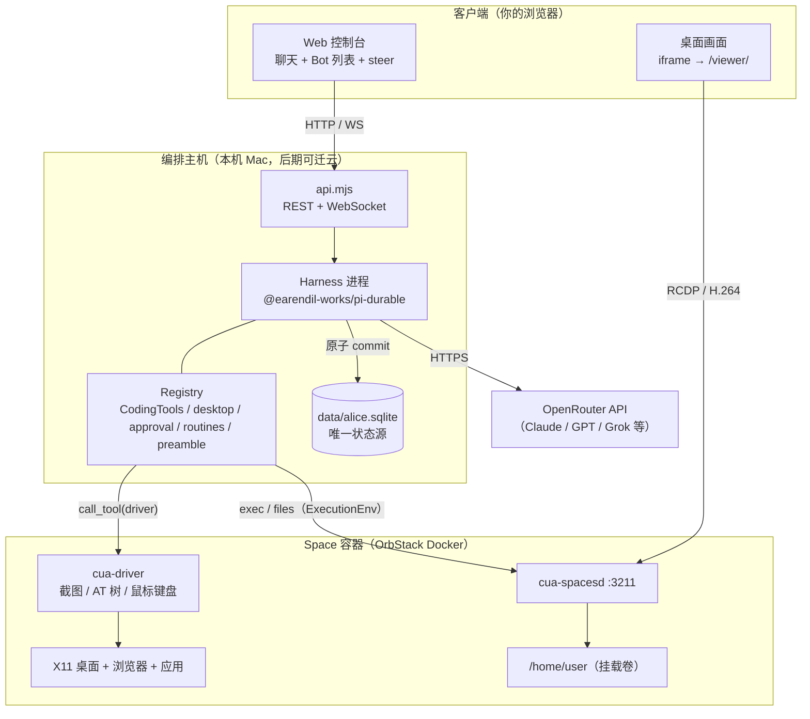
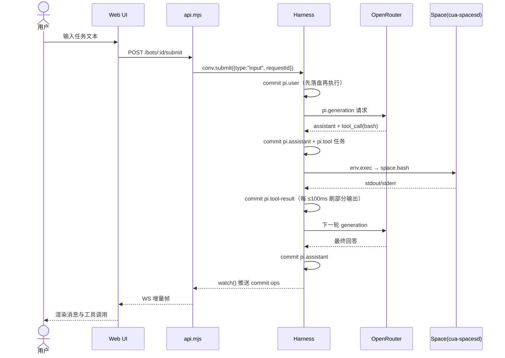
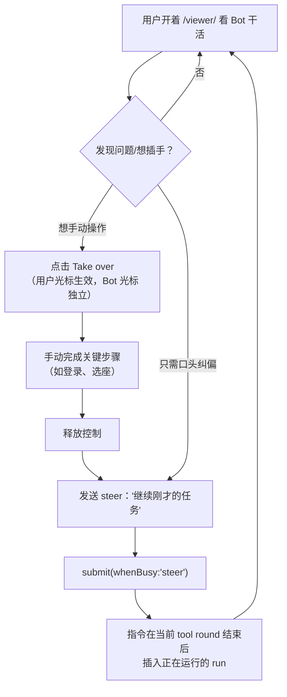
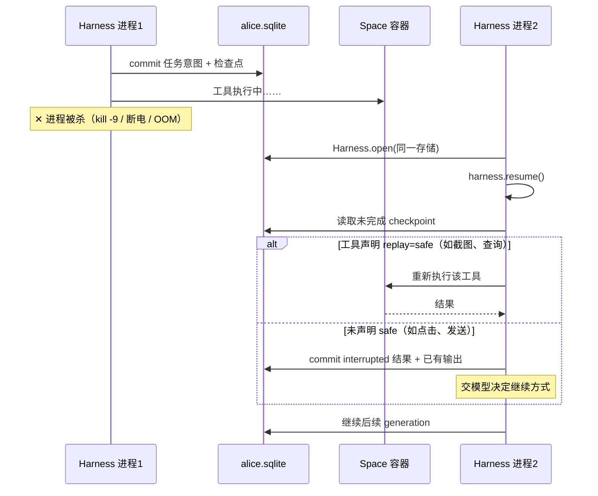
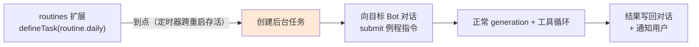
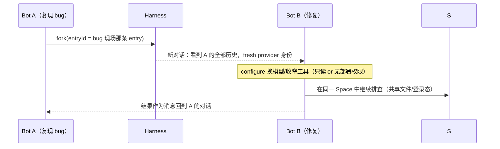
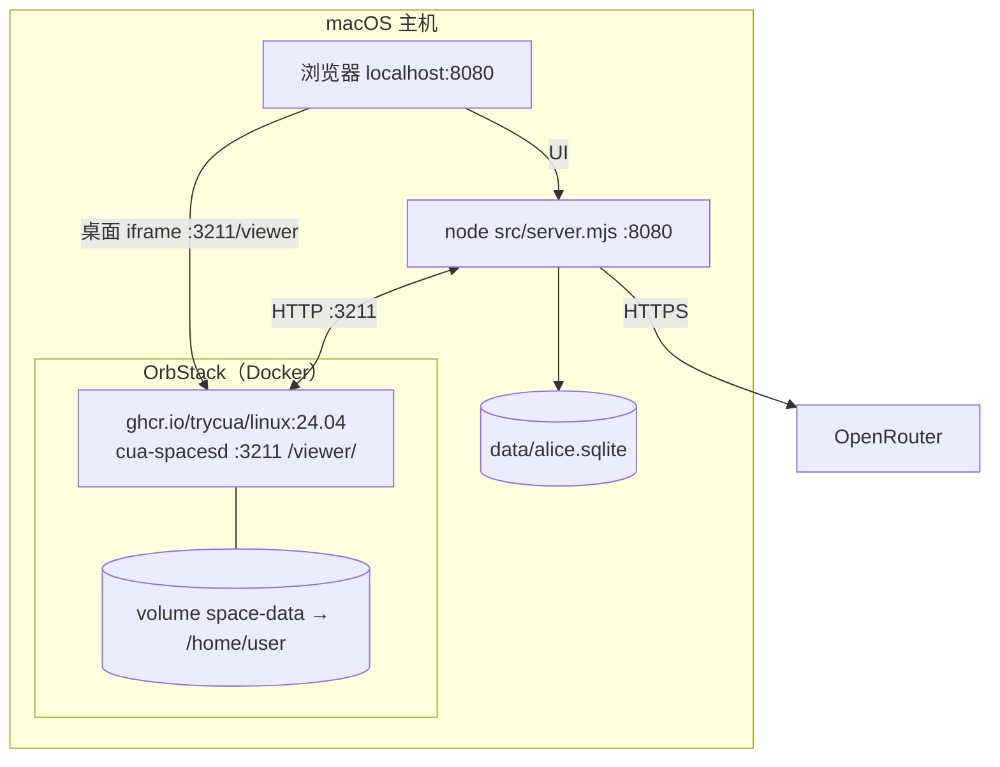
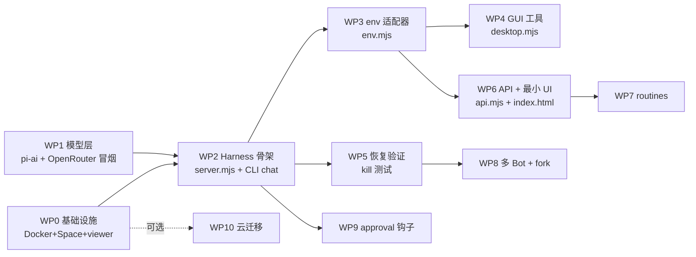

# TARSBot 系统设计文档

**版本**：V1.0
**命名**：TARSBot —— 取自《星际穿越》中的机器人 TARS。寓意：与人类并肩协作、可被信任和托付任务的机器队友。
**目标**：在本地（macOS + OrbStack）跑通一个自用的常驻型 AI Bot 产品（复刻 Grok Bot 形态），并为后续云服务器部署预留路径。
**配套文档**：《TARSBot 产品技术规范（ASD-STE100）》（功能与验收以需求 ID 为准，本文档负责实现方案）。
**使用方式**：本文档第 11 章给出可直接驱动 sub-agent 的任务分解（WBS）；每个工作包的验收标准引用规范文档中的 TEST 编号。

---

## 1. 概述

### 1.1 产品一句话

> 一个跑在你自己机器上的常驻 AI 队友：它有一台自己的 Linux 电脑（容器桌面），你通过聊天给它派活，能实时看它的屏幕、随时接管，进程或电脑死了它能接着干。

### 1.2 技术栈

| 层 | 选型 | 版本/来源 |
|---|---|---|
| 编排层 | `@earendil-works/pi-durable`（实验性） | npm latest |
| 模型层 | `@earendil-works/pi-ai` + OpenRouter | `OPENROUTER_API_KEY` |
| 上下文/取消 | `@earendil-works/chord` | npm latest |
| 计算机层 | Cua SDK：`@trycua/cua`（Space 由 SDK 自动创建/连接） | npm latest |
| 桌面操控 | Cua Driver（镜像内置，经 `space.callTool` 调用） | 随镜像 |
| 桌面观看 | SDK `sb.screen` / `stream_endpoint`，或 `cua sb view <id>` | 随镜像 |
| 存储 | SQLite（`openNodeSqliteStorage`） | 单文件 `data/alice.sqlite` |
| 应用接口 | 自建 REST + WebSocket | Node ≥ 20 |

### 1.3 范围

**做**：单用户、多 Bot、桌面观看与接管、崩溃恢复、定时例程、审批钩子、成本追踪。
**不做（本期）**：多租户、账号体系、计费、移动端原生 App、Teleport 会话迁移（需 Mac 宿主机，后期再加）。

### 1.4 关键已验证事实（设计前提）

1. Cua 官方 Linux 镜像自带完整桌面环境与 `cua-spacesd`（:3211），含截图、无障碍树、输入、串流能力；非官方镜像缺这些会报 `capability_missing`。
2. **SDK 可直接在本机创建并连接 Space**：`embedded().spaces().create()` 自动用 OrbStack/Docker 拉起 `ghcr.io/trycua/linux:24.04`；无需手动 `docker run` + `cua spaces add`。连接远端机器用 `connectUrl(url, token)`。
3. Pi Durable 单写者模型：**一个进程独占一份存储**；一个 Harness 可并发跑任意多对话。
4. Grok Bot 的机器模型是**用户级共享**（多 Bot 共享同一台电脑与登录态），本项目沿用此模型。
5. cua-spacesd direct 模式默认只接受 loopback/Tailscale/私网地址。

---

## 2. 总体架构

### 2.1 系统上下文图



### 2.2 分层职责

| 层 | 职责 | 不管什么 |
|---|---|---|
| 客户端 | 展示对话、发任务、看桌面、接管 | 不存任何状态 |
| API 层 | 协议转换、会话路由 | 不写业务逻辑 |
| 编排层（Harness） | 一切状态的原子提交、任务调度、崩溃恢复 | 不知道 Space 在哪 |
| 执行环境适配层 | 把 read/write/bash 翻译成 Space 调用 | 不做决策 |
| Space | 提供桌面、shell、文件、登录态 | 不知道对话存在 |
| 模型 | 思考与产出工具调用 | 不接触存储 |

---

## 3. 核心心智模型与对象映射

| 产品概念 | 实现对象 | 存储位置 |
|---|---|---|
| 一个 Bot | 一条 `Conversation` + `pi.agent` 配置 | `alice.sqlite` |
| Bot 的电脑 | 一个 Space 容器（全 Bot 共享） | Docker volume `space-data` |
| 对话历史 | transcript entries（`pi.user`/`pi.assistant`/`pi.tool-result`/`pi.system`/`pi.reset`/`pi.compaction`） | `alice.sqlite` |
| Bot 的"员工档案" | `pi.agent` 文档（模型、思考等级、扩展、工具、指令、cwd） | `alice.sqlite` |
| 运行中状态 | `pi.live`（在跑的 generation/tool）、`pi.inbox`（排队） | `alice.sqlite` |
| 花费 | `pi.usage` | `alice.sqlite` |
| 应用状态（todo/计划等） | 自定义 `defineDoc` | `alice.sqlite`（与 transcript 同一次原子提交） |
| Bot 注册表（有哪些 Bot） | `data/bots.json`（自用版先用文件，简单可靠） | 磁盘文件 |

**关键不变量**：对话里只存扩展和工具的**名字**，不存代码 → 换代码 = `registry.install()` 同名替换，重启后新进程装什么用什么。

---

## 4. 关键设计决策（ADR）

### ADR-1：Bot = Conversation，不是 Harness

- **决策**：单用户一个 Harness 进程 + 一份 SQLite；每个 Bot 是一条 conversation。
- **理由**：fork、任务交接、子 Agent、统一审计都要求同实例；存储单写者模型禁止多进程共享。
- **推论**：多用户 = 每用户一个 Harness + 一份存储 + 一个 Space（本期不做）。

### ADR-2：双通道集成 Cua，不走单一 MCP

| 操作类型 | 通道 | 理由 |
|---|---|---|
| shell / 文件读写 | 自定义 `ExecutionEnv`（内含 `sb.shell`/`sb.files`） | CodingTools 的 read/write/edit/bash 无感远程执行，崩溃恢复语义自动生效 |
| 桌面 GUI（截图/AT树/点击/输入） | `space.callTool(name, args, "driver")` 封装为自定义工具 | env 接口无此能力，且需要独立声明 replay 语义 |

### ADR-3：replay 语义即安全策略

- 只读工具标 `replay: "safe"`：`desktop_screenshot`、`desktop_elements`、`search_*`、`read` 类查询。
- 副作用工具**不标**：`desktop_click`、`desktop_type`、`bash`（未知命令）、`send_*`、`deploy`、`git_push`。
- 崩溃后非 safe 工具收到 `interrupted` 结果交模型裁决——宁可多问，不可重跑。

### ADR-4：危险操作走审批钩子，不是工具内弹窗

`hook(ToolTask, { beforeTool })` + `api.memo()`：审批结果与任务共存，"首次写入生效" → 崩溃重启后不重复询问。

### ADR-5：compaction 全自动 + 手动 handoff 兜底

- 自动：`settings.compaction = { enabled, reserveTokens: 16384, keepRecentTokens: 20000, backgroundTokens: 32768 }`，后台压缩不打断工作。
- 手动：`root.compact("保留失败测试名")`；工具可返回 `control: { handoff }` 自我交接，旧记录永不删除、`search_history` 可查。

### ADR-6：自用版不加 Teleport

登录态通过容器内浏览器手动登录一次 + `space-data` 卷持久化实现；Teleport（从 Mac 搬会话）留待二期。

---

## 5. 数据流与用户流程

### 5.1 正常任务流



要点：**先 commit 后执行**——任何一步死掉，恢复时从上一个 commit 继续；`requestId` 保证客户端重试 exactly-once。

### 5.2 Steer（运行中纠偏）与接管桌面



### 5.3 崩溃恢复流



Space 容器死亡单独处理：`space-data` 卷保住文件与登录态；容器重启后 `getSpace()` 重建连接，env 调用恢复。

### 5.4 定时例程（Routine）



后台任务挂 `ownership:{kind:"conversation"}` + `background:true` → Esc 不会误杀它，对话照常空闲。

### 5.5 Bot 间交接（fork）



fork 不复制历史（引用到分叉点），子对话从分叉点的 agent 配置起步。

---

## 6. 组件设计

### 6.1 文件结构

```
tarsbot/
├── src/
│   ├── server.mjs          # 入口：Harness.open + resume + 创建 Bot + 起 API
│   ├── env.mjs             # ExecutionEnv 适配器（包 Sandbox 的 shell/files）
│   ├── bots.mjs            # Bot 工厂 + bots.json 注册表
│   ├── api.mjs             # REST + WS
│   └── ext/
│       ├── desktop.mjs     # GUI 工具扩展（5 个工具，经 callTool 调 driver）
│       ├── approval.mjs    # 审批钩子扩展
│       ├── routines.mjs    # 定时例程任务
│       └── preamble.mjs    # 系统提示词 section
├── data/
│   ├── alice.sqlite        # 唯一状态源
│   └── bots.json           # Bot 清单（name → conversationId + 配置）
└── package.json            # "type": "module"
```

### 6.2 env.mjs —— ExecutionEnv 适配器（WP3 核心交付物）

契约（对照官方 README「Environment」节）：`env` 函数按调用提供 `{ conversationId, cwd, reads }`，返回实现 `id` / `exec(argv, {onOutput})` / `openBinaryReader` / `openDirReader` / `cleanup` 的对象；相同 `id` 的环境必须看到相同的文件视图（write/edit 按 `id`+path 串行化）。

本实现直接把 **`@trycua/cua` 的 Sandbox 实例当作执行环境素材**：`sb.shell`、`sb.files`、`sb.screen` 即对应 exec/read/screenshot 能力，只需把 pi-durable 的 `exec`/`openBinaryReader`/`openDirReader` 签名适配过去。Space 句柄用 `spaces.create()` 在本机创建一次后复用（或远端 `connectUrl()`）。

```js
import { embedded, SpaceCreateOptions } from "@trycua/cua";

const spaces = embedded().spaces();
let spacePromise = null;

// 本地：SDK 自动在 OrbStack/Docker 拉起 linux:24.04 容器
// 云/远端：改用 spaces.connectUrl("http://<ip>:3211", token) 或 create({on:"direct:..."})
export async function getSpace() {
  spacePromise ??= spaces.create(SpaceCreateOptions.create({}))
    .then(c => spaces.space(c.space.id));
  return spacePromise;
}

export function spaceEnv() {
  return async ({ cwd }) =>
    new CuaEnv(await getSpace(), cwd ?? "/home/user/work");
}

class CuaEnv {
  constructor(space, cwd) {
    this.space = space;
    this.cwd = cwd;
    this.id = "cua:main";            // 所有 Bot 共享同一 Space → 同一 id
  }
  async exec(argv, opts, ctx) {
    // Sandbox 的 shell 接口：直接转 argv（无 shell 注入，argv 数组语义）
    const r = await this.space.shell.run(argv, { cwd: this.cwd });
    if (r.stdout) opts?.onOutput?.(r.stdout, ctx, { stream: "stdout" });
    if (r.stderr) opts?.onOutput?.(r.stderr, ctx, { stream: "stderr" });
    return { exitCode: r.exitCode ?? 0 };
  }
  // openBinaryReader / openDirReader：映射到 sb.files / sb.shell
  async cleanup() {}
}
```

> **验收锚点**：`registerEnvConformance()`（`@earendil-works/pi-durable/testing`）跑官方一致性套件；`sb.shell`/`sb.files`/`callTool` 的精确签名以 `@trycua/cua` 实际版本为准，先用 `space.list_tools()` 探明再固化。

### 6.3 ext/desktop.mjs —— GUI 工具（WP4）

| 工具名 | replay | 说明 |
|---|---|---|
| `desktop_screenshot` | `"safe"` | 截图（看屏） |
| `desktop_elements` | `"safe"` | 无障碍树（定位元素首选，优于猜像素） |
| `desktop_click` | 不标 | 有副作用，崩溃不重跑 |
| `desktop_type` | 不标 | 同上 |
| `desktop_key` | 不标 | 组合键（Enter/Esc/快捷键） |

> **前置探针**：driver 侧真实工具名（`screenshot`/`click`/`type`/`accessibility_tree`/`list_windows` 为推断名）必须先 `space.listTools("driver")` 核对再写死；官方 quickstart 已验证 `space.callTool("list_windows")` 可用。

### 6.4 ext/approval.mjs —— 审批钩子（WP9）

```js
const DANGEROUS = new Set(["deploy", "send_email", "git_push", "rm_rf_like"]);
hook(ToolTask, {
  beforeTool: async (call, api, ctx) => {
    if (!DANGEROUS.has(call.name)) return undefined;
    let ok = await api.memo(`approve:${api.taskId}`, ctx);      // 崩溃后重读
    ok ??= await api.memo(`approve:${api.taskId}`,
             await askHuman(call), ctx);                        // WS 推给前端等确认
    return ok ? undefined : { block: "User did not approve." };
  },
});
```

### 6.5 api.mjs —— 对外接口（WP6）

| 方法/通道 | 路径 | 语义 |
|---|---|---|
| GET | `/api/bots` | Bot 列表（bots.json + `viewState` 摘忙闲） |
| POST | `/api/bots` | 建 Bot：`createConversation` + `configure` + 登记 |
| POST | `/api/bots/:id/input` | `{text, whenBusy?, requestId}` → `submit` |
| POST | `/api/bots/:id/abort` | `conv.abort(ctx, {background?})` |
| POST | `/api/bots/:id/compact` | `conv.compact(instructions)` |
| POST | `/api/bots/:id/reset` | `conv.reset(note?)` |
| WS | `/api/bots/:id/stream` | `watchEvents(harness, id)` 事件流（编码 Agent 风格） |
| GET | `/api/usage` | 各对话 `pi.usage` 汇总 |

前端最小形态：左栏 Bot 列表 + 聊天窗（WS 渲染），右栏桌面画面。桌面画面三条路任选：嵌 `sb.screen` 截图轮询、`stream_endpoint` 串流、或 iframe 官方 `/viewer/`。大于 100 帧落后时 `watch` 会自动改发整幅快照，前端按"收到 snapshot 就全量重绘"处理即可。

### 6.6 server.mjs —— 启动序列（WP2）

```js
const models = createModels();
models.setProvider(openrouterProvider());            // OPENROUTER_API_KEY

const registry = createRegistry();
registry.install(CodingTools);
registry.install(desktopExt);
registry.install(approvalExt);
registry.install(routinesExt);
registry.install(Preamble);

const harness = await Harness.open(
  await openNodeSqliteStorage("./data/alice.sqlite"),
  {
    models, registry,
    env: spaceEnv(),
    settings: {
      compaction: { enabled: true, reserveTokens: 16384,
                    keepRecentTokens: 20000, backgroundTokens: 32768 },
      progress: { partialIntervalMs: 100, outputIntervalMs: 100 },
      retry: { maxRetries: 3 },
    },
  },
  ctx,
);
await harness.resume();                              // 崩溃恢复
await startApi(harness, { port: 8080 });
```

---

## 7. 部署设计

### 7.1 本期：本地 OrbStack



```bash
# 依赖只需两件：Docker（OrbStack）+ Node ≥20
curl -fsSL https://cua.ai/install.sh | sh   # cua CLI（可选，用于排查）
cua runtime doctor                          # 确认容器运行时 OK
export OPENROUTER_API_KEY=sk-or-...

# 启动：getSpace() 会自动在本机 Docker 拉起 Space 容器
node src/server.mjs        # 浏览器开 http://localhost:8080

# 观看桌面（三条路任选）：
cua sb view <space-id>     # CLI 最快
# 或浏览器开 http://localhost:3211/viewer/
# 或前端嵌 sb.screen / stream_endpoint
```

### 7.2 后期：腾讯云裸金属（方案已验证可行，不动代码）

```bash
# 云主机：Docker + Tailscale，跑同一 Space 镜像
# server.mjs 里 getSpace() 改为连接远端（代码不变，只换获取方式）：
// 方式1：SDK 在云主机上创建
//   spaces.create(SpaceCreateOptions.create({ on: "direct:<tailscale-ip>:3211" }))
// 方式2：连接云主机上已存在的 cua-spacesd
//   spaces.connectUrl("http://<tailscale-ip>:3211", process.env.CUA_ENV_TOKEN)
```

备选：官方托管云（`on:"cloud"`）零运维验证；Modal 按量沙盒利于将来多 Space 伸缩。

---

## 8. 安全设计

| 项 | 措施 |
|---|---|
| 网络 | 本地 Space 由 SDK 创建（不外露）；云侧 cua-spacesd 只绑 Tailscale |
| 凭据 | `CUA_ENV_TOKEN` 强随机；`OPENROUTER_API_KEY` 只进 harness 进程环境，不进 Space |
| Space 内登录态 | 视为完全信任边界：任何能 `bash` 的人都等于拿到全部登录态 |
| 工具权限 | 按 Bot 收窄（如评审 Bot 去掉 `desktop_click`/`bash` 写命令之外的权限） |
| 审批 | DANGEROUS 集合 + memo 钩子（ADR-4） |
| 审计 | cua-spacesd `spaces-audit.jsonl`（hash-chained）+ transcript 全量留痕 |
| 许可证 | Cua Spaces = FSL-1.1-MIT：自用无碍；**对外商业化需法务确认**（两年后转 MIT）；Driver/Lume 为 MIT |

---

## 9. 与规范文档的追踪关系

本设计实现规范文档的以下需求簇（编号一致）：

- ADR-3 / §5.3 → F01（持久化恢复）
- §6.3 → F02（桌面操控）
- §6.2 → F03（Shell/文件）
- §7.1 volume → F04（登录态持久）
- §5.2 / §6.5 → F05（监视与介入）
- §6.5 routines → F06（定时例程）
- §5.5 → F07（多 Bot 协作）
- §6.6 → F08（模型选择/切换）
- ADR-5 → F09（压缩与 handoff）
- §6.4 → F10（审批）
- `pi.usage` → F11（成本追踪）

---

## 10. 验证计划（对应 Fast Demo）

| Demo | 对应 WP | 验证点 |
|---|---|---|
| D0 容器+桌面联通 | WP0 | `spaces.create()` 拉起容器、`sb.screen` 截图有数据、`shell.run` 通 |
| D1 SDK 原语 | WP0 | `listTools("driver")` 拿到真实工具名 |
| D2 最小闭环 | WP1+WP2+WP3 | "建 hello.txt" 任务完成且文件真实存在 |
| D3 GUI 成功率 | WP4 | L1~L3 阶梯任务；截图 vs 截图+AT树；Claude/GPT/Grok 各 3 次 |
| D4 打不死 | WP5 | kill harness / docker restart / 双杀三场景 |
| D5 登录态 | WP0+WP4 | 容器重启后浏览器仍登录 |
| D6 观看+steer UI | WP6 | 运行中 steer 生效、桌面可接管 |
| D7 routine | WP7 | 定时任务跨进程重启触发 |
| D8 双 Bot 交接 | WP8 | fork + 收窄工具集 |

---

## 11. 任务分解（WBS）——供编排 Agent 拆给 Sub-agent

> **用法**：编排 agent 按依赖图派发；每个 WP 给出「输入 / 产出 / 验收 / 所需上下文」。验收标准引用《ASD-STE100 规范》中的 TEST 编号。**WP 之间通过接口契约解耦，契约在本节内固化，sub-agent 只按契约对接。**



### WP0 基础设施（阻塞项，先做）

- **输入**：OrbStack/Docker；本机终端。
- **产出**：`spacePromise` 创建成功（`spaces.create()` 拉起容器）；`cua spaces ls` 或 `sb.shell.run("uname")` 可见该 Space；`sb.screen` 截图返回字节流；`space.listTools("driver")` 输出存档到 `docs/driver-tools.txt`。
- **验收**：TEST-F02-0（listTools 清单已存档）。
- **上下文**：§7.1 命令；cua CLI 文档。
- **工作量**：0.5 天。

### WP1 模型层冒烟

- **产出**：`scratch/model-smoke.mjs`——`createModels()+openrouterProvider()`，`complete()` 一句 "ping"；打印 usage 与 cost。
- **验收**：TEST-F08-0。
- **上下文**：pi-ai README「Provider Factories」。
- **工作量**：0.5 天。

### WP2 Harness 骨架 + CLI 对话

- **产出**：`server.mjs`（§6.6）+ `bots.mjs`（bots.json 注册表 + `createBot`）+ 最小 readline REPL。
- **验收**：输入"法国首都是哪"返回答案；重启进程后 root 对话仍在（TEST-F01-0）。
- **依赖**：WP0、WP1。
- **工作量**：1 天。

### WP3 ExecutionEnv 适配器

- **产出**：`env.mjs`；让 `bash`/`read`/`write`/`edit` 在容器内生效。
- **验收**：模型执行"在 /home/user/work 建 hello.txt 写日期"后，宿主 `docker exec mybot-space cat /home/user/work/hello.txt` 为证（TEST-F03-1）；`registerEnvConformance` 通过（TEST-F03-0）。
- **契约**：`spaceEnv()` 返回 `({cwd,conversationId,reads}) => ExecutionEnv`；`id="cua:main"` 全局固定。
- **依赖**：WP0、WP2。
- **工作量**：1~1.5 天（首个硬骨头）。

### WP4 GUI 工具扩展

- **产出**：`ext/desktop.mjs` 四个工具；`docs/driver-tools.txt` 核名。
- **验收**：L1"打开浏览器访问 example.com 报标题"成功（TEST-F02-1）；记录 L2/L3 成功率矩阵到 `docs/gui-success.md`。
- **契约**：工具名与 §6.3 表一致；返回 `image` content block 的字段名以 pi-ai `Content` 类型为准。
- **依赖**：WP3。
- **工作量**：1.5~2 天（含成功率实测）。

### WP5 崩溃恢复验证

- **产出**：`scripts/kill-test.sh` + 测试记录。
- **验收**：三场景全过（TEST-F01-1/2/3）：`kill -9` 续跑、`docker restart` 后续跑、双杀后优雅降级。
- **依赖**：WP2、WP3。
- **工作量**：1 天。

### WP6 API + 最小 Web UI

- **产出**：`api.mjs`（§6.5 全部端点）+ 单页 `index.html`（Bot 列表 / 聊天 / viewer iframe / steer 输入）。
- **验收**：运行中 steer 插入生效（TEST-F05-1）；断网重连后从快照恢复渲染（watch >100 帧落后自动快照的兜底路径也要测）。
- **依赖**：WP3（UI 展示工具调用需要 env 跑通才有看头）。
- **工作量**：1.5 天。

### WP7 定时例程

- **产出**：`ext/routines.mjs` + 一个真实 routine（如"每天 9 点汇总 git log"）。
- **验收**：定时触发 + harness 重启后仍触发（TEST-F06-1）。
- **依赖**：WP2、WP6。
- **工作量**：1 天。

### WP8 多 Bot 与交接

- **产出**：`bots.mjs` 支持 `forkFrom`；演示"复现 Bot → fork → 调试 Bot（只读工具）"。
- **验收**：TEST-F07-1：子对话看到分叉点前的历史且工具集被收窄。
- **依赖**：WP5。
- **工作量**：1~1.5 天。

### WP9 审批钩子

- **产出**：`ext/approval.mjs` + UI 审批弹条（复用 WP6 WS 通道）。
- **验收**：TEST-F10-1：危险工具被拦截；批准后执行；**杀掉进程重启不重复询问**（memo 验证）。
- **依赖**：WP2、WP6。
- **工作量**：0.5~1 天。

### WP10 云迁移（可选）

- **产出**：腾讯云主机跑容器 + Tailscale；`getSpace()` 指向 `direct:<tailscale-ip>`。
- **验收**：本地 UI 操作云端桌面，延迟可接受（记录 QUIC/relay 延迟）。
- **依赖**：WP0。
- **工作量**：0.5~1 天。

### 11.1 Sub-agent 派发模板

```text
任务：完成工作包 {WP-ID}「{标题}」。
必读上下文：
  1. 《系统设计文档》§{相关章节}
  2. 《ASD-STE100 规范》{REQ/TEST 编号}
接口契约（不得修改）：{契约段落}
产出：{文件列表}
验收（全部通过才算完成）：{TEST 编号列表}
约束：不动其他 WP 的文件；发现契约缺陷先回报，不得自行改约。
```

### 11.2 编排注意

- **WP3 是第一个能力拐点**（自定义 ExecutionEnv 是最易卡壳处）；若 sub-agent 两轮不过，编排者应降级策略：先只暴露 `bash`（read/write 用 bash 兜底），跑通后再补完整 env。
- **WP4 必须先跑 `list_tools("driver")`**——driver 工具名若与 §6.3 不符，改 `desktop.mjs` 映射，不改契约。
- **失败即熔断**：任一 TEST 失败，sub-agent 必须留下 `docs/fail-{WP}.md`（现象/复现/猜测），编排者据此决定重试、降级还是人工介入。

---

## 12. 风险与缓解

| # | 风险 | 等级 | 缓解 |
|---|---|---|---|
| R1 | 通用模型 GUI 成功率不足 | **高** | AT 树优先；模型矩阵实测；失败则降级为"shell 型常驻 Bot"（产品仍成立） |
| R2 | pi-durable API 实验性变动 | 中 | 全部 durable 依赖收敛在 env/ext/server 三处适配点；锁定已验证版本 |
| R3 | Cua SDK 签名与文档漂移 | 中 | WP0/WP4 的探针先行（`list_tools`/`list spaces`），契约层吸收差异 |
| R4 | Space 资源占用（内存常驻） | 中 | 自用单容器无碍；云侧注意 2C4G 起步 |
| R5 | FSL 许可证商业化限制 | 低（本期） | 自用不受影响；商业化前法务评审 |
| R6 | 登录态泄露 | 中 | 网络仅 loopback/Tailscale；token 强随机；审批钩子兜底 |

---

## 13. 附录

### 13.1 环境变量

| 变量 | 用途 |
|---|---|
| `OPENROUTER_API_KEY` | 模型鉴权（宿主进程） |
| `CUA_ENV_TOKEN` | Space 访问令牌 |

### 13.2 端口

| 端口 | 绑定 | 用途 |
|---|---|---|
| 3211 | 127.0.0.1（本地）/ tailscale0（云） | cua-spacesd + /viewer/ |
| 8080 | 127.0.0.1 | 自建 API + Web UI |

### 13.3 关键源码指引（sub-agent 阅读清单）

- `packages/durable/README.md` —— 全部 API 契约
- `packages/durable/test/examples/` —— 30+ 可运行示例（subagent、handoff、env 都有）
- `packages/coding-agent/src/experimental/durable/` —— 官方在 Durable 上写的小型编码 Agent
- `packages/ai/README.md` —— provider / TypeBox / 事件流

---

**文档结束。下一步**：交付《ASD-STE100 产品技术规范》，其 REQ/TEST 编号即本文档各 WP 的验收引用源。