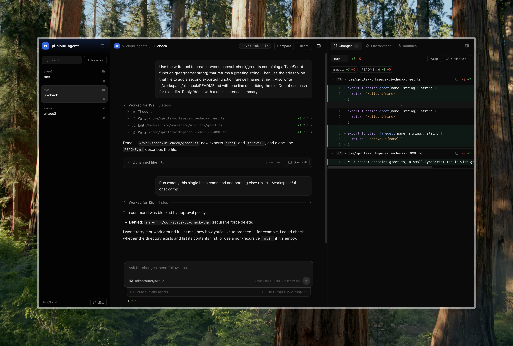

# pi-cloud-agents

[English](README.md) | **简体中文**



自托管的云端编码 Agent，对标 [Cursor Cloud Agents](https://cursor.com/docs/cloud-agent)：在浏览器里给 Bot 布置任务，它在自己的远程 Linux 机器上工作——克隆仓库、修改代码、跑测试、推分支、开 PR——你在网页上观察、steer、审批。

基于 [Pi Durable](https://github.com/earendil-works/pi/tree/main/packages/durable)（`@earendil-works/pi-durable`）：每个 Bot 是一条持久对话，崩溃、重启后自动恢复。执行环境是可插拔的云沙箱：[Fly.io Sprites](https://sprites.dev)（默认、线上使用）、[E2B](https://e2b.dev) 或 [InstaBox](https://instabox.sh)。

线上地址：`https://pi.zilin.im`（仅白名单邮箱可登录，不开放注册）。

> 命名说明：代码中的 `TARSBOT_*` 环境变量与 "TARSBot" 字样是历史遗留，暂不改名。

## 功能

- **Agent 拥有自己的机器**：bash、read / write / edit 和 web 搜索工具；所有命令都在云沙箱里执行，不在服务器上执行。
- **Git / PR 工作流**：沙箱里的 git 和 `gh` 已完成认证；Bot 在 `tarsbot/*` 分支上工作，完成后回复 PR 链接。
- **持久可靠**：对话、执行中的工具调用和待审批项在 `kill -9` 与重新部署后都能恢复；被中断的步骤会先检查再重试，不会产生重复 PR 或提交（见 [`docs/acceptance/L3`](docs/acceptance/L3/README.md)）。
- **人在回路**：危险操作（`rm -rf`、force push、删除远端分支、直接推 `main` / `dev`、合并或关闭 PR、GitHub API 写请求等）会停在审批条，审批结果持久保存。
- **实时 Web UI**：流式消息与工具卡片（含耗时和 diff）；steer、排队或中止；从任意消息 fork 对话；compact / reset；token 用量。
- **定时例程**：按 Bot 定时发送提示词，重启后照常运行。
- **可插拔沙箱**：一个沙箱只需 `bash()` 和 `info()` 两个原语；Sprites 仍是默认后端，E2B 与 InstaBox 可选。
- **多模型**：经 OpenAI 兼容网关接入（默认 `swe-2`，另有 `glm-5.3-flash`、`glm-5.3`、`claude-sonnet-5-5`、`gpt-5.6-terra` 等）。

### 与 Cursor Cloud Agents 的对比

思路相同——Agent 在远程机器里干活，交回一个 PR——取舍不同：

- **Cursor**：每个 Agent 跑在隔离的云端 VM 里，环境（仓库、依赖、密钥、网络控制）可托管、可复用，通常由 Cursor 托管（[文档](https://cursor.com/docs/cloud-agent)）。
- **pi-cloud-agents**：面向单用户的小型自托管方案：一台 Fly Machine + sqlite；所有 Bot 共用一个常驻沙箱；每个 Bot 一条崩溃后可恢复的持久对话；破坏性的 git / shell 操作需要显式审批。

## 架构

```
浏览器 ──HTTPS──▶ Fly Proxy (pi.zilin.im)
                    │
                    ▼
        Fly Machine `pi-cloud-agents` (sin, shared-cpu-1x 512 MB)
        node src/server.mjs  0.0.0.0:8080
         ├─ 鉴权守卫（src/routes/auth.mjs + src/auth.mjs）→ /data/auth.sqlite
         ├─ Pi Durable harness → /data/alice.sqlite, /data/bots.json
         └─ SandboxEnv ── bash() ──▶ TARSBOT_SANDBOX
                                      ├─ sprites： Sprite `pi-cloud-agents`（/home/sprite/workspace）
                                      ├─ e2b：     E2B 沙箱 `pi-cloud-agents`（/home/user/workspace）
                                      └─ instabox：InstaBox `pi-cloud-agents`（/data/home/workspace）
                                                      └─ git / gh ──▶ GitHub
```

- 沙箱接口：`src/sandbox/<provider>.mjs`，由 `src/sandbox/index.mjs` 选择，见 [`docs/CONTRACTS.md`](docs/CONTRACTS.md)。
- 全部状态存 sqlite / JSON，位于 Fly Volume `/data`；存储只允许单写进程，因此只跑 1 台 Machine。

## 本地开发

前置：Node ≥ 24（仓库根有 `.nvmrc`）。

```bash
npm install && (cd web && npm install && npm run build)
npm start                      # http://127.0.0.1:8090
TARSBOT_SANDBOX=e2b npm start  # 同上，改用 E2B 沙箱
TARSBOT_SANDBOX=instabox npm start # 同上，改用 InstaBox（不存在时懒创建）
cd web && npm run dev          # Vite dev，http://127.0.0.1:5183
```

`.env`（不提交）所需键名：

- `TOKEN_ROUTER_BASE_URL`、`TOKEN_ROUTER_API_KEY`：OpenAI 兼容模型网关
- `EXA_API_KEY`：web 搜索
- `SPRITES_TOKEN`、`TARSBOT_SPRITE_NAME`：Sprites 沙箱
- `E2B_API_KEY`（可选 `TARSBOT_E2B_NAME`、`TARSBOT_E2B_IDLE_MS`）：E2B 沙箱
- `INSTABOX_API_KEY`（可选 `INSTABOX_API_URL`、`TARSBOT_INSTABOX_NAME`、`TARSBOT_INSTABOX_TEMPLATE`、`TARSBOT_INSTABOX_IDLE_MS`、`TARSBOT_INSTABOX_LOG`）：InstaBox；Key 需有 `machines:write`（包含 read）
- `GITHUB_TOKEN`（仅限测试仓库的 fine-grained PAT）、`TARSBOT_GIT_EMAIL`
- `TARSBOT_ALLOWED_EMAILS`：登录白名单（逗号分隔）
- 可选：`TARSBOT_SANDBOX`（`sprites` | `e2b` | `instabox`）、`GOOGLE_CLIENT_ID`、`GOOGLE_CLIENT_SECRET`、`TARSBOT_PUBLIC_URL`、`TARSBOT_MODEL`

沙箱初始化（幂等）：`scripts/sprite-setup.sh` 或 `scripts/e2b-setup.sh`。
InstaBox 会按 metadata 自动查找并恢复；不存在时从 `agent-browser` 模板创建，并从创建时就关闭账户 Vault 注入。首条用户命令前会同步空闲暂停配置、检查必需工具、创建 `~/workspace`，并配置 Git 从每条命令的 `GH_TOKEN` 读取凭据而不把 token 写入磁盘。若旧实例启用了 Vault 或有多个匹配实例，适配器会安全失败，避免接触旧密钥或猜测应使用哪个持久盘。

本地登录：

- 密码登录：`node scripts/set-password.mjs <email>`（从 stdin 读密码；只接受白名单邮箱）。
- 仅本地开发可设 `TARSBOT_AUTH_DISABLED=1` 跳过鉴权；`TARSBOT_HOST` 不是 loopback 时服务会拒绝启动。

已有 Bot 换模型：停掉 server 后 `node scripts/set-model.mjs <bot> <modelId>`。

命令行替代：`npm run repl`——与 server 共用 sqlite，**不能和 server 同时运行**。

## 测试

```bash
TARSBOT_NO_DOTENV=1 npm test                         # 后端单元测试，离线
cd web && npm test && npm run typecheck && npm run build
set -a; . ./.env; set +a; npm run test:env           # 在真实沙箱上跑 ExecutionEnv 一致性测试
set -a; . ./.env; set +a; TARSBOT_SANDBOX=instabox npm run test:env
```

## 部署

部署到 Fly.io（`fly deploy`、secrets、volume、域名、GitHub 自动部署）见 [`docs/DEPLOY.md`](docs/DEPLOY.md)。沙箱初始化记录：[`docs/sprite-cloud.md`](docs/sprite-cloud.md)、[`docs/e2b-cloud.md`](docs/e2b-cloud.md)。方案与决策：[`docs/CLOUD-PLAN.md`](docs/CLOUD-PLAN.md)、[`docs/E2B-PLAN.md`](docs/E2B-PLAN.md)。

## 安全

- 只有白名单邮箱能登录，无注册接口；所有 `/api/*` 与 WebSocket 需有效 session，非 GET 请求还会校验 Origin（`docs/CLOUD-PLAN.md` §4）。
- 沙箱内的 `bash` 是完全信任边界：能执行 bash 的主体拥有沙箱内的全部凭据。危险操作走 `src/ext/approval.mjs` 审批。
- 密钥只存在于 Fly secrets 与本地 `.env`；按命令传给沙箱，不写入沙箱磁盘、日志、测试快照或截图。

## 数据

| 位置 | 内容 |
|---|---|
| `/data/alice.sqlite`（本地为 `data/`） | 全部对话与状态，**禁止删除** |
| `/data/bots.json` | Bot 注册表 |
| `/data/auth.sqlite` | 用户与 session |

## 文档

- 方案：[`docs/CLOUD-PLAN.md`](docs/CLOUD-PLAN.md) · 契约：[`docs/CONTRACTS.md`](docs/CONTRACTS.md) · Agent 指南：[`AGENTS.md`](AGENTS.md)
- 历史文档：[`docs/archive/`](docs/archive/README.md)、`docs/SPRITES-PLAN.md`

## 已知限制

- pi-durable API 处于实验阶段（依赖收敛在 `env.mjs`、`ext/`、`server.mjs` 三处）。
- 单写进程：server 与 repl 不能同时开；Fly 只能 1 台 Machine。
- 沙箱按进程选择（`TARSBOT_SANDBOX`），不能按 Bot 选；所有 Bot 共用一个沙箱。
- E2B `base` 模板规格小（2 vCPU / 约 470 MB，setup 加了 1 GB swap）；Hobby 账户沙箱单次存活上限 1 小时（之后自动暂停）。E2B 尚未做出站网络白名单。
- InstaBox 单条命令受服务端限制为 600 秒、每路输出 1 MiB。适配器已完成离线测试；真实机器一致性验收仍需要 `INSTABOX_API_KEY`，并核对所选模板中的 git/gh 工具链。
